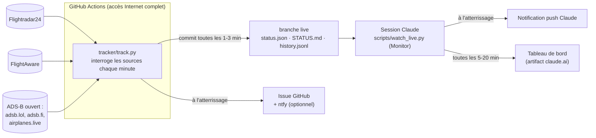

# notif-parents

Suivi en direct du vol **AF902 Yaoundé (NSI) → Paris-CDG** du 16-17 octobre 2026,
avec une notification à l'atterrissage et un tableau de bord consultable au réveil.

| | |
|---|---|
| Vol | Air France AF902, Boeing 787-9 (F-HRBJ) |
| Départ | Yaoundé-Nsimalen, prévu 22:25, parti à 23:34 heure locale (00:34 à Paris) |
| Arrivée | Paris-CDG **terminal 2E**, horaire initial 06:35, annoncé 07:35 par Paris Aéroport à 01:53 |
| Où suivre | Tableau de bord : https://claude.ai/artifact/UnLs1cMzQsfqRqoLqU6RxC · statut minute par minute : [`STATUS.md` sur la branche `live`](../../blob/live/STATUS.md) |

## Comment ça marche

1. **Le traqueur** (`tracker/track.py`) tourne dans GitHub Actions, parce que
   l'environnement cloud de Claude n'a pas le droit de joindre les sites de suivi
   de vols (Flightradar24, FlightAware, adsb.lol… sont refusés par sa politique
   réseau). GitHub Actions, lui, a un accès Internet complet.
   Il interroge les sources chaque minute pendant 5 h 45 au maximum, et s'arrête
   45 min après l'atterrissage ou dès l'arrivée à la porte.
2. **La branche `live`** reçoit l'état du vol : `status.json` (données complètes),
   `STATUS.md` (lisible sur GitHub, y compris dans l'app mobile) et `history.jsonl`
   (un point par minute). Les commits sont toutes les 3 min en croisière,
   toutes les minutes dans l'heure qui précède l'arrivée.
3. **La session Claude** surveille cette branche (`scripts/watch_live.py`,
   lancé dans l'outil Monitor). Pour consommer peu de tokens, elle ne se
   réveille que pour l'atterrissage, un traqueur muet depuis plus de 8 min, et
   un rafraîchissement du tableau de bord toutes les 30 min (10 min en descente).
   Elle envoie la notification push à l'atterrissage.
4. **Des réveils programmés** (06:45, 07:00, 07:15, 07:30, 07:50, plus deux
   pendant la nuit) relancent la surveillance si le conteneur de la session a été
   recyclé, et rattrapent la notification si elle a été manquée.

## Notifications à l'atterrissage

Trois canaux indépendants, pour qu'au moins un passe :

| Canal | Déclenché par | Ce qu'il faut |
|---|---|---|
| Notification push Claude (+ fichier envoyé dans la conversation) | la session Claude | rien, c'est le canal principal |
| Issue GitHub « AF902 a atterri à CDG (hh:mm) » avec mention `@Arata4526` | le traqueur, sans dépendre de Claude | notifications GitHub activées (app GitHub mobile ou e-mail) |
| ntfy, sujet `af902-093bf9a590` | le traqueur | app [ntfy](https://ntfy.sh) installée et abonnée à ce sujet (optionnel). Envoie aussi « début de descente » et « au terminal » |

## Sources et fiabilité des heures

| Source | Ce qu'elle donne | Remarque |
|---|---|---|
| Flightradar24 | heure d'atterrissage estimée et réelle, porte, tapis, trace satellite | estimation retenue en priorité |
| FlightAware | atterrissage et arrivée à la porte, estimés et réels | souvent un peu optimiste en début de vol |
| ADS-B ouvert (adsb.lol, adsb.fi, airplanes.live) | position brute, altitude, vitesse | peu de couverture au-dessus du Sahara, excellente sur la Méditerranée et la France ; sert au calcul « distance / vitesse » et à voir l'avion au sol |
| Paris Aéroport | annonce 07:35 relevée à 01:53 (capture d'écran) | correspond à l'horaire initial + le retard au départ ; elle ne se met pas à jour ici |

Au décollage, les estimations allaient de 06:46 (FlightAware) à 07:04 (Flightradar24),
contre 07:35 annoncé par Paris Aéroport. Elles convergent pendant le vol : le
tableau de bord en trace l'évolution.

**Sortie des passagers** : le tableau de bord affiche une fourchette indicative
de 30 à 60 min après l'atterrissage (roulage, police aux frontières, bagages).
À 01:53, Paris Aéroport affichait 0 min d'attente aux contrôles du 2E.

## Détection de l'atterrissage

Le premier de ces signaux l'emporte :

1. Flightradar24 donne une heure réelle d'arrivée ou le statut `landed` ;
2. FlightAware donne une heure réelle d'atterrissage ;
3. l'ADS-B voit l'avion **au sol à moins de 10 km de CDG** ;
4. l'ADS-B a vu l'avion en courte finale (sous 2 500 ft, à moins de 25 km)
   puis plus aucun signal pendant plus de 4 min.

Le vol du jour est choisi par son horaire de départ (le plus proche du
16/10 21:25 UTC), pour ne jamais confondre avec l'AF902 de la veille.

## Fichiers

| Fichier | Rôle |
|---|---|
| `tracker/track.py` | le traqueur (Python, bibliothèque standard uniquement) |
| `.github/workflows/suivi-af902.yml` | lance le traqueur à chaque push sur `claude/suivi-af902` touchant `tracker/` ou le workflow ; une nouvelle exécution remplace l'ancienne |
| `scripts/watch_live.py` | surveillance de la branche `live` ; `python3 scripts/watch_live.py --once` affiche l'état courant |
| `dashboard/arrivee-af902.html` | source du tableau de bord publié sur claude.ai |

## Relancer ou réutiliser

- **Relancer le traqueur** : onglet Actions → « Suivi AF902 » → *Re-run jobs*,
  ou pousser un changement dans `tracker/`. L'état (atterrissage, notifications
  déjà envoyées) est relu depuis la branche `live`, donc rien n'est envoyé deux fois.
- **Autre vol** : changer en tête de `tracker/track.py` les constantes `FLIGHT`,
  `CALLSIGNS` (indicatif OACI, ex. `AFR902`), les horaires et les aéroports, ainsi
  que la requête Flightradar24 (`query=af902`) et l'URL FlightAware.
- **Coût** : le dépôt est privé, une nuit de suivi consomme environ 6 h de
  minutes GitHub Actions (le forfait gratuit en inclut 2 000 par mois).
  Le traqueur ne consomme aucun token Claude ; seule la session Claude en
  consomme, à chaque réveil (une vingtaine de tours courts sur la nuit).

## Limites connues

- Flightradar24 et FlightAware sont lus via leurs API web non officielles :
  ils peuvent changer de format ou bloquer. Le traqueur continue avec les
  sources restantes, et l'état de chaque source est visible dans `STATUS.md`
  et en bas du tableau de bord.
- Le tableau de bord ne peut pas interroger Internet lui-même (sécurité des
  artifacts claude.ai) : il affiche ce que la session Claude y pousse, avec
  l'heure de la donnée. Pour la minute près, `STATUS.md` ou les liens directs
  font foi.
- La notification push Claude suppose que la session soit réveillée à temps ;
  l'issue GitHub et ntfy n'en dépendent pas.
